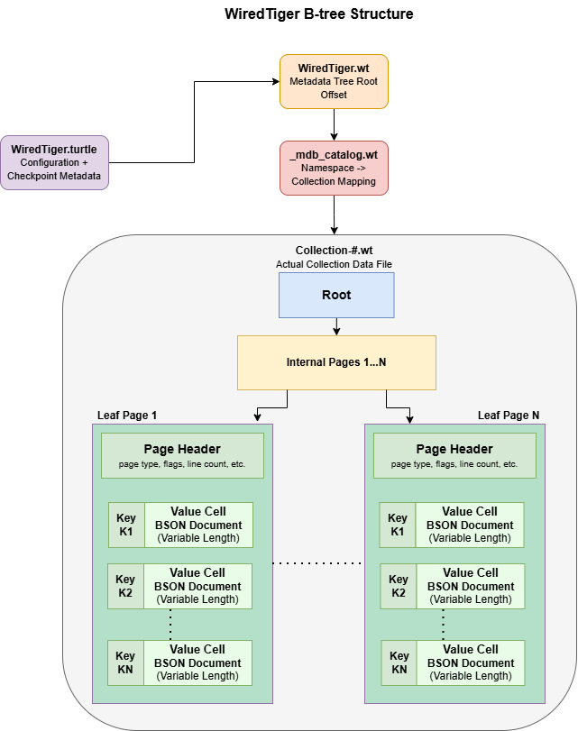

# MongoDB Forensics: Recovering Tampered Records from WiredTiger Storage Files

This repository contains the implementation and experimental artifacts from a forensic study investigating the recovery of tampered MongoDB records from WiredTiger storage files.

The study examines how historical record versions persist within WiredTiger page structures, how checkpoint timing influences recoverability, and how replication lag affects forensic reconstruction in distributed MongoDB deployments.

---

## Overview

Modern versions of MongoDB rely on the WiredTiger storage engine, which uses a non-in-place update model, update chains, page-based storage, and checkpoint-driven persistence.

While previous research has focused primarily on deleted record recovery, limited work has examined whether modified or tampered records leave recoverable remnants within WiredTiger storage files.

This study investigates:

- Recovery of tampered records without relying on logs.
- The effect of checkpoint timing on data persistence.
- Recovery opportunities created by delayed replication.
- The practical limits of historical state reconstruction in MongoDB.

---

## WiredTiger Internal Storage Architecture

<p align="center">
  
</p>

*Simplified view of WiredTiger page structures and metadata relationships used during recovery.*

---

## Recovery Pipeline

The recovery process operates directly on WiredTiger storage files and does not rely on oplogs, journals, transaction logs, or MongoDB server instrumentation.

High-level workflow:

1. Parse `WiredTiger.turtle`
2. Locate metadata root pages
3. Resolve collection files
4. Traverse live B-trees
5. Scan all pages within `.wt` files
6. Identify orphan leaf pages
7. Extract BSON documents
8. Reconstruct document timelines using `_id`

Recovered records are classified as:

- Unchanged
- Modified
- Deleted

---

## Repository Structure

```text
.
├── Experiments/
│
├── Recovery Algorithm/
│
└── README.md
```

---

## Experimental Environment

### Standalone Environment

| Component | Specification |
|------------|------------|
| MongoDB | 8.3 |
| CPU | Intel Core i7-12700 |
| RAM | 32 GB |
| Operating System | Windows 11 |

### Distributed Environment

| Configuration | Value |
|------------|------------|
| Replica Set Members | 3 |
| Delayed Secondary | Yes |
| Replication Delay | 5 Minutes |
| Storage Engine | WiredTiger |

---

## Workloads

A database containing 100,000 BSON documents was created and subjected to controlled tampering operations.

### Workload A

Per round:

- 500 Deletes
- 500 Modifications

### Workload B

Per round:

- 500 Inserts
- 500 Deletes
- 500 Modifications

Ten rounds were executed, producing up to 5,000 modified and deleted records.

---

## Checkpoint Scenarios

Four checkpoint strategies were evaluated:

1. Single checkpoint after all rounds
2. Default WiredTiger checkpointing (60 seconds)
3. Checkpoint after every round
4. Checkpoint every k rounds (k = 3)

The objective was to measure how checkpoint timing influences the persistence of historical record versions.

---

## Results

### Key Findings

- Historical document versions remain recoverable within orphan WiredTiger pages.
- Recovery success is strongly influenced by checkpoint timing.
- Recently modified records exhibit the highest recovery rates.
- Older versions disappear as WiredTiger reuses storage pages.
- Delayed replication significantly extends the forensic recovery window.
- Distributed deployments provide multiple temporal perspectives on the same workload.

### Recovery Behavior

| Scenario | Recovery Observation |
|-----------|-----------|
| Single Checkpoint | 100% recovery |
| Default Checkpointing | Approximately 10–12% recovery |
| Checkpoint Every Round | Most recent batch fully recoverable |
| Checkpoint Every 3 Rounds | Intermediate recovery window |
| Delayed Secondary | 100% modification recovery |

---

## Contributions

- Investigates tampered-record recovery in modern MongoDB deployments.
- Analyzes WiredTiger page structures and update propagation.
- Develops a storage-level recovery pipeline operating directly on `.wt` files.
- Quantifies the effect of checkpoint timing on recoverability.
- Evaluates forensic recovery in both standalone and distributed deployments.
- Demonstrates how delayed replication can extend recovery opportunities.

---

